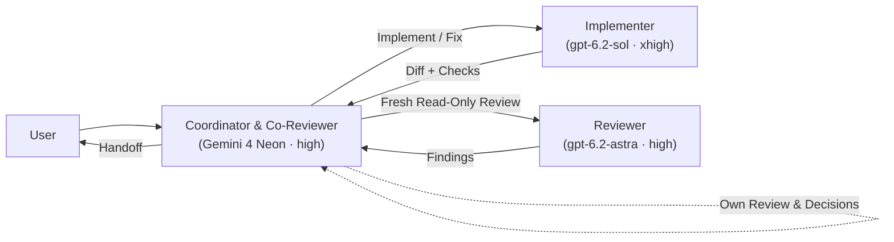

# neon-orchestrator

A lean, cross-harness Agent Skill for **Antigravity**, **Claude Code**, **Codex**, and **Gemini CLI** that defines a clear three-role orchestration setup — intentionally lightweight so strong models stay flexible on large projects and long tasks.

## Roles & Defaults

| Role | Model | Default Effort | Scope |
| :--- | :--- | :--- | :--- |
| **Coordinator & Co-Reviewer** | Active agent (recommended: **Gemini 4 Neon**) | **`high`** (always `high` for Neon 4) | Coordinates, reviews independently, arbitrates findings, makes decisions — no direct production coding |
| **Implementer** | `gpt-6.2-sol` (`codex`) | **`xhigh`** (`high` only for small tasks) | Implementation, tests, verification, agreed review fixes |
| **Independent Reviewer** | `gpt-6.2-astra` (`codex`) | **`high`** | Fresh, read-only review per round |

*Refusal fallback: if a `6.2` worker refuses a delegated instruction due to copyright or internal policy rules, retry only that step with its predecessor (`gpt-6.1-sol` / `gpt-6-astra`) and then switch back to `6.2` for subsequent steps.*



## Installation

### Global (all four harnesses)

```bash
npx skills add Auda29/neon-orchestrator -g -a antigravity -a claude-code -a codex -a gemini-cli
```

### Project-local

```bash
npx skills add Auda29/neon-orchestrator
```

## Usage

Invoke the skill in any project to start orchestrated work:

- **German:**
  > Nutze den `neon-orchestrator` Skill, um Feature X umzusetzen.
- **English:**
  > Use `neon-orchestrator` to implement feature X.

## Repository Layout

```text
neon-orchestrator/
├── LICENSE
├── README.md
├── assets/
│   └── icon.svg
└── skills/
    └── neon-orchestrator/
        ├── SKILL.md
        └── references/
            └── harness-adapters.md
```

## License

[MIT](./LICENSE)

## Credits

Created in [T3 Code](https://t3.codes).
