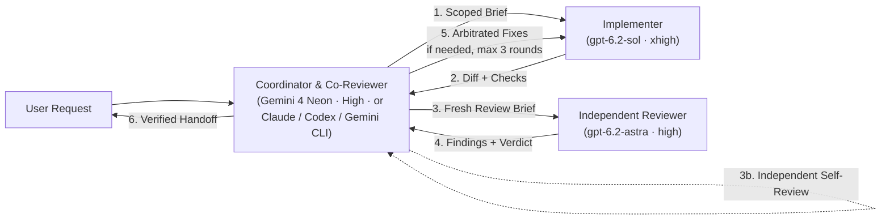

# neon-orchestrator

A cross-harness Agent Skill for **Antigravity**, **Claude Code**, **Codex**, and **Gemini CLI** (both inside **T3 Code** and standalone) that turns your active agent — recommended: **Gemini 4 Neon (`high`, always)** — into a **Coordinator & Co-Reviewer** orchestrating **`gpt-6.2-sol` (`xhigh` default, `high` for small tasks)** for implementation and **`gpt-6.2-astra` (`high` default)** for independent code reviews.

## How It Works



### Core Principles

- **Clear separation of concerns**: The coordinator (Gemini 4 Neon always on `high`) scopes, reviews, arbitrates, and decides — it does **not** directly write production code.
- **Dedicated implementer**: `gpt-6.2-sol` (`xhigh` by default; `high` only for small/routine tasks) executes focused changes, writes tests, and runs verification commands.
- **Unbiased independent reviewer**: `gpt-6.2-astra` (`high` by default) reviews every round in a **fresh session** (read-only, zero anchoring bias).
- **Dual review with real judgment**: The coordinator inspects the diff independently before reading Astra's findings, merges both perspectives, adds its own architectural decisions, filters out false positives/nits, and sends Sol a single consolidated revision brief.
- **Multi-harness dispatch**: Automatically uses **T3 Code `delegate_task`** when available, **Codex `spawn_agent`** in standalone Codex when supported, or **`codex exec --ephemeral`** (`-s workspace-write` for Sol, `-s read-only` for Astra) in standalone Claude Code, Antigravity, and Gemini CLI.
- **Bounded loops**: Converges cleanly with a default cap of 3 review rounds before escalating genuine tradeoffs to the user.

## Supported Harnesses & Requirements

| Harness | Inside T3 Code | Standalone (Outside T3 Code) |
| :--- | :--- | :--- |
| **Antigravity** (e.g., Gemini 4 Neon High) | `delegate_task` (`codex` provider enabled) | `codex` CLI installed & authenticated |
| **Claude Code** | `delegate_task` (`codex` provider enabled) | `codex` CLI installed & authenticated |
| **Codex** | `delegate_task` (`codex` provider enabled) | `spawn_agent` or `codex` CLI |
| **Gemini CLI** | `delegate_task` (if T3 MCP attached) | `codex` CLI installed & authenticated |

## Installation

### Option 1: Universal CLI

```bash
npx skills add Auda29/neon-orchestrator
```

### Option 2: Global installation (available across all projects)

Symlink (or `cp -r`) the skill folder into each harness you use:

```bash
SKILL_SRC="/path/to/neon-orchestrator/skills/neon-orchestrator"

# Antigravity
mkdir -p ~/.gemini/config/skills
ln -sfn "$SKILL_SRC" ~/.gemini/config/skills/neon-orchestrator

# Gemini CLI
mkdir -p ~/.gemini/skills
ln -sfn "$SKILL_SRC" ~/.gemini/skills/neon-orchestrator

# Codex
mkdir -p ~/.codex/skills
ln -sfn "$SKILL_SRC" ~/.codex/skills/neon-orchestrator

# Claude Code
mkdir -p ~/.claude/skills
ln -sfn "$SKILL_SRC" ~/.claude/skills/neon-orchestrator
```

### Option 3: Project-local installation (shared via Git)

- **Antigravity, Codex, Gemini CLI (and newer Claude Code):**
  ```bash
  mkdir -p .agents/skills
  cp -r /path/to/neon-orchestrator/skills/neon-orchestrator .agents/skills/neon-orchestrator
  ```
- **Claude Code (if your version only reads `.claude/skills/`):**
  ```bash
  mkdir -p .claude/skills
  cp -r /path/to/neon-orchestrator/skills/neon-orchestrator .claude/skills/neon-orchestrator
  ```

## Usage

Start a session in **Antigravity (Gemini 4 Neon, High)**, **Claude Code**, **Codex**, or **Gemini CLI** and invoke the skill naturally:

- **English:**
  > Use the `neon-orchestrator` skill to implement OAuth token refresh with full test coverage.
- **German:**
  > Nutze den `neon-orchestrator` Skill, um das Refactoring der Billing-Pipeline umzusetzen und sauber reviewen zu lassen.
- **With custom overrides:**
  > Run `neon-orchestrator` (Sol on `high`, Astra on `xhigh`, max 2 rounds) to fix the race condition in the job queue.

## Repository Layout

```text
neon-orchestrator/
├── README.md
├── assets/
│   └── icon.svg
└── skills/
    └── neon-orchestrator/
        ├── SKILL.md
        └── references/
            ├── harness-adapters.md
            └── prompt-templates.md
```

## License

[MIT](./LICENSE)

## Credits

Created in [T3 Code](https://t3.codes).
